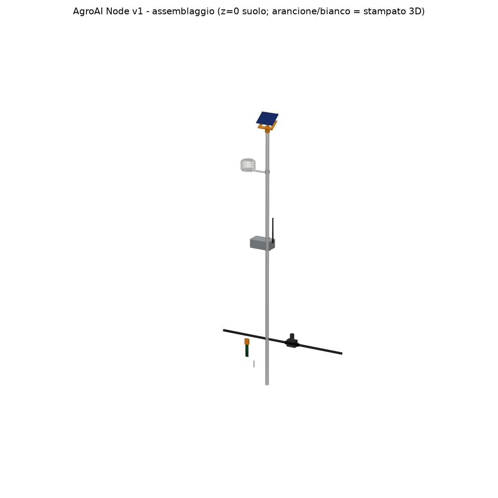
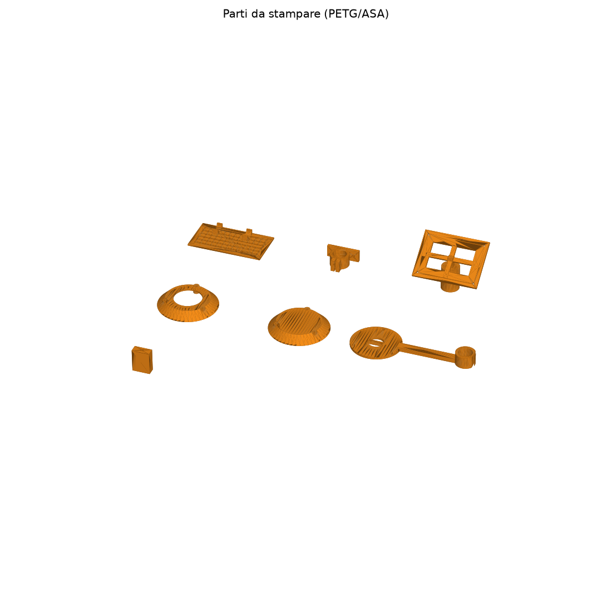

# AgroAI Node v1 — guida di costruzione

> **Stato:** progetto di prototipo. **Mai costruito né provato su hardware reale.**
> Le misure dei componenti acquistati (scatola, pannello, moduli) sono **nominali**: misura i tuoi pezzi
> e cambia i parametri in `cad/agroai_node.py` prima di stampare.
> I **prezzi sono stime** (novembre 2026), da ricontrollare al momento dell'acquisto. Dove c'è una fonte è citata.



## 1. Cos'è

Un palo di 2 m (1,6 m fuori terra) con sopra:

| Altezza | Parte | Cosa fa |
|---|---|---|
| ~1,65 m | Pannello solare 6 V su staffa stampata (35°) | ricarica la batteria |
| ~1,25 m | Schermo antiradiazione stampato (4 alette + tetto) | protegge SHT40 (aria T/UR) e BH1750 (luce). 1,25–2 m è l'altezza standard WMO per la temperatura dell'aria |
| ~0,7 m | Scatola IP65 su 2 collari stampati | Heltec WiFi LoRa 32 V3 (ESP32-S3 + LoRa SX1262), batteria 18650, caricatore, driver valvole |
| 10–30 cm sottoterra | Sensore capacitivo umidità + sonda DS18B20 | umidità e temperatura del suolo nella zona radici |
| a terra | Elettrovalvola 9 V *latching* sulla linea a goccia + flussimetro | irrigazione (opzionale) |

Radio: **WiFi** se il router arriva fin lì, altrimenti **LoRa 868 MHz** verso un secondo Heltec in casa (gateway) che inoltra al backend AgroAI via WiFi.

## 2. File

| File | Cosa |
|---|---|
| `cad/agroai_node.py` | modello parametrico (Python + manifold3d). Rigenera tutto |
| `stl/*.stl` | parti da stampare |
| `stl/assembly.obj` + `.mtl` | assemblaggio completo a colori: si apre con **Visualizzatore 3D** di Windows |
| `render/*.png` | anteprime |
| `render/print_stats.txt` | volume e filamento stimato per parte |

Rigenerare dopo aver cambiato le misure:

```powershell
pip install manifold3d numpy matplotlib
python hardware\agroai-node-v1\cad\agroai_node.py
```

## 3. Parti da stampare



| STL | Q.tà | Note di stampa |
|---|---|---|
| `mount_plate` | 1 | piastra interna, griglia fori M3 passo 10 mm per fissare qualsiasi modulo + culla per 18650 |
| `pole_clamp` | 2 | collare per tubo Ø25 mm, chiuso con vite M3; flangia con 2 fori M4 (interasse 40 mm) per la scatola |
| `panel_bracket` | 1 | si infila in cima al palo; piano a 35°. **Serve supporto** in stampa |
| `shield_plate` | 4 | alette coniche, si stampano così come sono (45°, niente supporti) |
| `shield_top` | 1 | tetto chiuso dello schermo |
| `shield_base_arm` | 1 | base con ponte per i sensori (fori M2,5) + braccio + collare |
| `probe_cap` | 1 | cappuccio per l'elettronica del sensore capacitivo, da riempire con resina |

- Materiale: **PETG** (va bene) o **ASA** (meglio al sole). **Niente PLA**: al sole si deforma.
- Schermo antiradiazione in **bianco**.
- Filamento: limite superiore calcolato **≈ 406 g** a riempimento 100% (`render/print_stats.txt`); con 3 perimetri e 30–40% di infill realisticamente ~200–280 g (stima).
- Se non hai una stampante: servizio di stampa online o fablab locale (chiedi preventivo con gli STL).

## 4. Distinta componenti (1 nodo)

### Elettronica e meccanica (nodo di monitoraggio)

| # | Componente | Scelta consigliata | Alternativa risparmio | Prezzo stimato |
|---|---|---|---|---|
| 1 | Scheda | **Heltec WiFi LoRa 32 V3, 868 MHz** | — | €23–25 ([Hexaspot](https://hexaspot.com/products/heltec-wifi-lora-32-v3), [Rokland](https://store.rokland.com/en-de/collections/heltec-products/products/heltec-wifi-lora-32v3)) |
| 2 | Umidità suolo | DFRobot SEN0193 | capacitivo v1.2 generico (con chip TLC555) | £4,4–4,8 + IVA ([Rapid](https://www.rapidonline.com/dfrobot-sen0193-gravity-analog-capacitive-soil-moisture-sensor-75-0246), [DigiKey](https://www.digikey.co.uk/en/products/detail/dfrobot/SEN0193/6588605)) · generico €1–3 (stima) |
| 3 | Temp. suolo | DS18B20 impermeabile + resistenza 4,7 kΩ | stesso, generico | €2–6 (stima) |
| 4 | Aria T/UR | Adafruit SHT40 (4885) | modulo SHT40 generico | $5,95 ([Adafruit](https://www.adafruit.com/products/4885)) · generico €2–4 (stima) |
| 5 | Luce | modulo BH1750 | — | €1,5–4 (stima) |
| 6 | Caricatore solare | modulo **CN3791** (versione 4,2 V Li-ion) | — | €2–5 (stima). Il DFRobot DFR0559 costa €11,57 ([Robot Italy](https://robot-italy.com/en/products/dfr0559-solar-power-manager-5v)) ma risulta fuori produzione presso alcuni rivenditori ([The Pi Hut](https://thepihut.com/products/solar-power-manager-5v)) |
| 7 | Pannello | 6 V 3–5 W | 6 V 2 W | €8–20 (stima) |
| 8 | Batteria | 18650 Li-ion di marca (Samsung/LG/Molicel) + portapila | — | €5–10 (stima) |
| 9 | Driver valvola | DRV8833 + MT3608 (boost a 9 V) + MOSFET AO3401 + condensatore 1000 µF 16 V | — | €3–6 (stima) |
| 10 | Antenna | 868 MHz 3 dBi SMA + pigtail u.FL→SMA da pannello | antenna in dotazione | €6–12 (stima) |
| 11 | Scatola | ABS IP65 ~158×90×60 mm + 5 pressacavi PG7 | — | €10–20 (stima) |
| 12 | Palo e viteria | tubo PVC Ø25 mm 2 m, 3 barre filettate M4, viti M3/M4, fascette | — | €8–15 (stima) |
| 13 | Filamento | PETG/ASA ~250 g | — | €5–10 (stima) |
| 14 | Cavi e sigillatura | cavo esterno 4 poli 5 m, guaina termorestringente, resina/silicone per elettronica, millefori, morsetti | — | €8–15 (stima) |
| | **Totale nodo di monitoraggio** | | | **≈ €90–170** |

### Irrigazione (opzionale, per zona)

| Componente | Prezzo stimato |
|---|---|
| Elettrovalvola 3/4" con solenoide **9 V DC latching** (es. DIG 305DC, Hunter/K-Rain con bobina latching) | $43–49 per valvola completa negli USA ([Saturn Supply](https://saturnsupplyco.com/v305dc-075), [Sprinkler Warehouse](https://www.sprinklerwarehouse.com/dig-305dc-inline-valve-with-flow-control-and-dc-latching-solenoid-3-4-in-fpt-305dc-075)); solo bobina $9–24 ([Home Depot](https://www.homedepot.com/p/300997526), [K-Rain](https://www.sprinklerwarehouse.com/k-rain-9v-dc-latching-solenoid-p3008114)). In Italia stima €30–50 |
| Flussimetro YF-S201 (economico, da calibrare) | €3–8 (stima) |
| Pluviometro a basculante con reed | €15–40 (stima) |
| **Totale irrigazione** | **≈ €35–60 per zona** (+ pluviometro) |

> Con serbatoio **a gravità** (bassa pressione) una elettrovalvola classica può non aprire: in quel caso usa una **valvola a sfera motorizzata** 5 V (tipo CR02), €10–20 (stima).

### Gateway LoRa (uno per tutta l'azienda, solo se non usi il WiFi)

Secondo Heltec V3 + alimentatore USB + antenna: **≈ €30–45**.

### Attrezzi (se non li hai)

Saldatore a temperatura regolabile (€25–60), multimetro (€15–40), spellafili, stagno (stime).

### Riepilogo costi

| Configurazione | Costo stimato |
|---|---|
| 1 nodo di monitoraggio + gateway LoRa | ≈ €120–215 |
| 1 nodo con 1 zona irrigua + gateway | ≈ €155–275 |
| Ogni nodo in più (monitoraggio) | ≈ €90–170 |

## 5. Collegamenti (Heltec V3)

> ⚠️ **Verifica ogni pin sul pinout ufficiale Heltec V3 prima di saldare.** I pin LoRa (8–14),
> OLED (17/18/21), `Vext` (36) e lettura batteria (1/37) sono usati dalla scheda: non usarli.

| Segnale | GPIO | Note |
|---|---|---|
| Alimentazione sensori | `Vext` 3,3 V (comandata da GPIO 36, attiva bassa) | i sensori si spengono in deep sleep → consumo minimo |
| Umidità suolo AOUT | 7 | ADC1 |
| DS18B20 DATA | 6 | 4,7 kΩ verso 3,3 V |
| Pluviometro (reed) | 5 | verso GND, pull-up interno; può svegliare dal deep sleep |
| Flussimetro (impulsi) | 4 | **partitore 10 kΩ / 4,7 kΩ** se alimentato a 9 V: l'uscita non deve superare 3,3 V |
| I2C sensori esterni SDA / SCL | 41 / 42 | bus separato da quello dell'OLED; SHT40 (0x44) + BH1750 (0x23) |
| Valvola 1 (DRV8833 IN1/IN2) | 47 / 48 | impulso 50–100 ms: verso = apri / chiudi (controlla il datasheet della valvola) |
| Valvola 2 (DRV8833 IN3/IN4) | 39 / 40 | opzionale |
| Abilitazione boost 9 V (AO3401 high-side) | 2 | il boost è spento tranne durante l'impulso |
| Batteria | connettore JST batteria della Heltec | uscita del CN3791 → 18650 → JST |

**Prima di collegare il DRV8833**: regola il trimmer del MT3608 a **9,0 V col multimetro** (il DRV8833 regge al massimo 10,8 V).

**Batteria:** un 18650 Li-ion **non va caricato sotto 0 °C**. Il CN3791 non lo impedisce da solo. Per zone con gelate serve la versione PCB v2 con LiFePO4 e caricatore dedicato.

## 6. Costruzione passo per passo

1. **Stampa** le parti (sezione 3) in PETG/ASA.
2. **Prova al banco via USB** (senza pannello e senza scatola): Heltec + sensori su breadboard. Verifica che arrivino dati al backend AgroAI.
   Firmware: [`firmware/agroai_node_v1`](../../firmware/agroai_node_v1/README.md) con `BENCH_MODE 1`. Per LoRa serve anche il gateway: [`firmware/agroai_lora_gateway`](../../firmware/agroai_lora_gateway/README.md).
3. **Calibra il sensore di umidità**: valore all'aria (secco) e in acqua fino alla linea (bagnato) → `SOIL_RAW_DRY` / `SOIL_RAW_WET`. Meglio ancora: calibra nel tuo terreno.
4. **Sigilla** l'elettronica del sensore capacitivo: `probe_cap` riempito di resina. I bordi del PCB tagliati vanno coperti con smalto o termorestringente.
5. **Monta l'elettronica** sulla `mount_plate` (viti M3 + distanziali), poi la piastra nella scatola. Fai 5 fori per i pressacavi **sul fondo** (mai sopra: entra l'acqua) e un foro per il connettore SMA.
6. **Pianta il palo**: 40 cm nel terreno (o in un tubo/plinto). Monta i collari e la scatola, poi lo schermo (barre M4 + dadi tra le alette, 12–13 mm di distanza) e la staffa del pannello orientata **a sud**.
7. **Sonde nel suolo** a ~30 cm dal palo, nella zona radici della coltura (10–30 cm). Il terreno intorno va ricompattato: le sacche d'aria falsano le misure.
8. **Valvola**: collega la bobina latching al DRV8833. Prova prima apri/chiudi a mano, poi il programma automatico con tempo massimo di apertura.
9. **Collaudo di 1–2 settimane**: controlla consumi, tensione della batteria giorno/notte, portata radio e acqua nella scatola dopo la pioggia.

## 7. Dopo il prototipo: PCB AgroAI v2

Quando il nodo v1 funziona, i moduli (Heltec, CN3791, DRV8833, MT3608) si sostituiscono con **un unico PCB** che entra nella stessa scatola sulla stessa piastra:
- modulo ESP32-S3 certificato + SX1262;
- caricatore LiFePO4;
- alimentazione sensori comandata;
- 2 uscite valvola;
- morsetti a vite.

Lo si progetta in KiCad e lo si fa assemblare da JLCPCB. Per il montaggio "Economic" JLCPCB indica un costo di setup di $8,18 più ~$0,0016 a punto di saldatura, a cui si aggiungono i componenti ([JLCPCB – PCB assembly price](https://jlcpcb.com/help/article/pcb-assembly-price)). Il costo reale si sa solo con il preventivo online, dopo il disegno.
