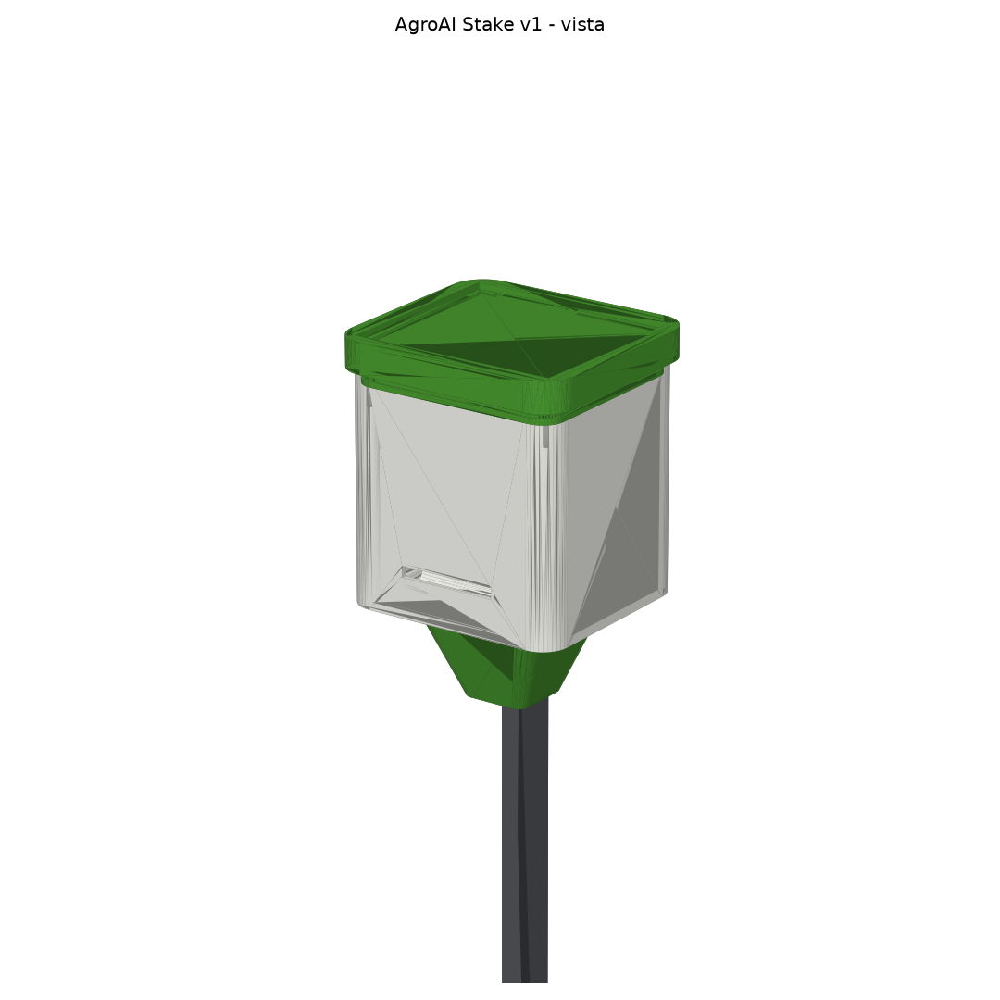
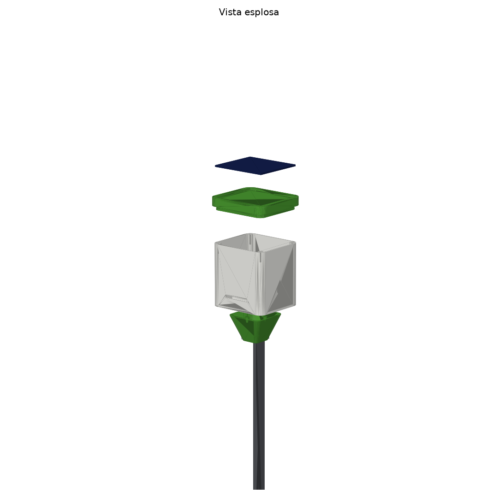
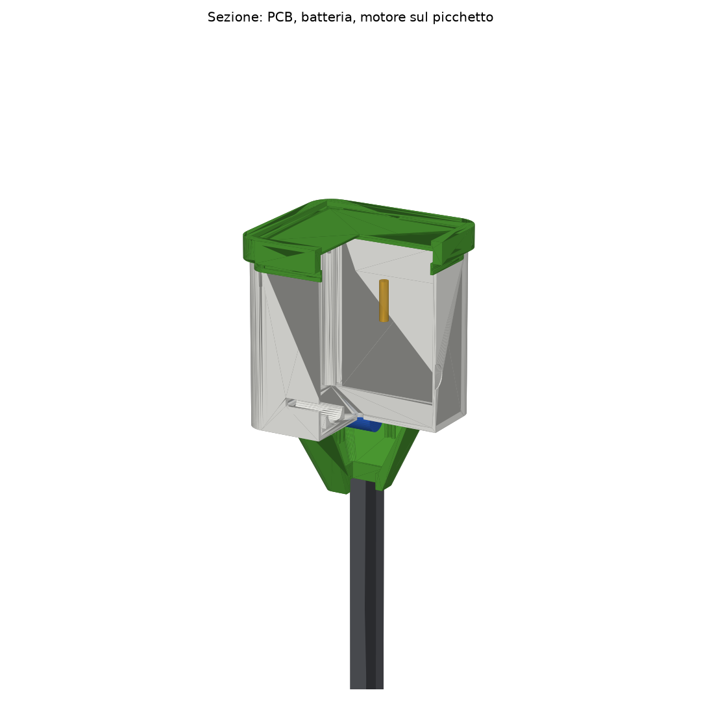

# AgroAI Stake v1 — paletto autonomo (solare + LoRa + vibrazione antitalpa)

> **Stato: proposta da confermare.** Niente è stato costruito o provato. I prezzi sono **stime** (novembre 2026), da
> ricontrollare. I consumi marcati "ipotesi" vanno **misurati** sul prototipo.

Forma come nell'immagine di riferimento:
- scatola bianca/verde con pannello solare sul tetto, logo AGRO AI e LED verde di stato;
- sotto, un picchetto da piantare nel terreno.

Si pianta, si accende con il magnete e lavora da solo. Parla via LoRa con un gateway in casa, senza cavi tra i paletti.

## 1. Onestà sulla vibrazione antitalpa

**Non ci sono prove che le vibrazioni allontanino le talpe.**
- Penn State Extension: nessun dispositivo elettronico, magnetico o a vibrazione è stato dimostrato efficace ([fonte](https://extension.psu.edu/moles)).
- Washington State University: nei test controllati nessun repellente elettronico ha funzionato ([fonte](https://extension.wsu.edu/snohomish/garden/gardening-resources/moles/)).
- UC Davis (Baldwin): la ricerca non conferma l'efficacia dei dispositivi di spavento, vibranti compresi ([fonte](https://baldwin.ucdavis.edu/download_file/view/43/268)).
- Michigan State: i vibratori sono considerati inefficaci ([fonte](https://www.canr.msu.edu/uploads/files/moles.pdf)).

Quindi AgroAI Stake va presentato come **strumento per sperimentare**, non come repellente garantito. Il prototipo include:
- **Accelerometro** (LIS3DH) sul paletto: misura quanta vibrazione arriva davvero nel terreno. Con un secondo paletto "sonda" si può misurare a 0,5–1–2 m.
- **Prova in campo con controllo**:
  - 2–4 settimane di base: si spianano i cumuli e si contano quelli nuovi ogni settimana;
  - poi metà delle parcelle con vibrazione accesa e metà con paletti identici ma motore spento;
  - 4–8 settimane di confronto.
  
  Solo questo dato dice se funziona nel tuo terreno.

Per il controllo delle talpe, le stesse fonti indicano la **cattura** come metodo più efficace.

## 2. Architettura

```
 [Paletto x 6-7 per ettaro]                                [Casa]
  pannello 6 V ─► caricatore con NTC ─► 18650 ─► 3,3 V      Gateway LoRa (Heltec V3, USB)
  ESP32-S3 + SX1262 (LoRa 868) ◄──── LoRa ──────────────►     │ WiFi
  driver ─► motore a vibrazione (fissato al picchetto)          ▼
  accelerometro · LED verde · interruttore magnetico      Backend AgroAI ─► app sul telefono
  (opz.) umidità suolo, aria T/UR, pioggia
```

- Gateway e protocollo sono quelli già scritti in `firmware/agroai_lora_gateway` (LoRa punto-punto, firmati HMAC, il gateway non conosce le chiavi).
- Per molti ettari si può passare a LoRaWAN in futuro.
- Con 6–7 paletti per ettaro e un invio ogni 10 minuti il canale LoRa è molto scarico.

## 3. Consumi e dimensionamento (calcolo)

| Voce | Ipotesi | mAh/giorno |
|---|---|---|
| Sonno (PCB custom) | 0,05 mA, **da misurare** | 1,2 |
| Invio stato ogni 10 min | sveglio 4 s a ~60 mA, 144 volte | 9,6 |
| Risveglio per ogni impulso del motore | 0,3 s a 30 mA | 0,0025 × impulsi |
| Motore | corrente **da misurare** × duty cycle | vedi sotto |

Riferimenti esterni per il motore: Bird-X dichiara < 20 mA in vibrazione per il suo picchetto ([istruzioni](https://bird-x.com/filebin/pdf/instructions/TX-Mole-Instructions.pdf)); paletti generici dichiarano 45–55 mA per tutto l'apparecchio ([esempio](https://rebates.com/amazon-coupons/product_details/B0DQ7ZWZM3/Phosooy-6-Packs-Solar-Mole-Repellers,-Gopher-Deterrent-Device-with-Vibrating-Motor-&-Spiral-Drill-Ground-Stake,-IP65-Waterproof-Lawn-Garden-Yard-Pest)). Calcolo con 50 mA (motore debole) e 150 mA (più forte):

| Programma di vibrazione | motore 50 mA | motore 150 mA |
|---|---|---|
| A: 1 s ogni 20 s, 24 h | 82 mAh/g | 202 mAh/g |
| B: 2 s ogni 60 s, 24 h | 54 mAh/g | 134 mAh/g |
| C: 2 s ogni 60 s, solo 10 h | 29 mAh/g | 62 mAh/g |

**Batteria**, caso peggiore 202 mAh/giorno:
- 4 giorni senza sole → 810 mAh;
- diviso 0,8 (scarica massima) e 0,8 (freddo) → **~1 300 mAh necessari**.

Un **18650 da 3 000 mAh** basta con margine (circa 9 giorni senza sole).

Se si usa la scheda Heltec nel prototipo, il sonno può costare molto di più: un utente ha misurato circa 2 mA a scheda "spenta" ([forum Meshtastic](https://meshtastic.discourse.group/t/heltec-v3-shutdown-light-versus-deep-sleep/9930)), cioè +48 mAh/giorno. Rientra comunque, ma è un motivo per il PCB custom.

**Pannello**, caso peggiore:
- 202 mAh × 3,7 V ≈ 0,75 Wh/giorno;
- ipotesi prudente per dicembre: 1 ora equivalente di sole pieno, da verificare per il tuo campo con [PVGIS](https://re.jrc.ec.europa.eu/pvg_tools/en/) (gratuito, Commissione Europea);
- rendimento complessivo 50% (caricatore, batteria, sporco, ombra della coltura);
- 0,75 / (1 × 0,5) = 1,5 W, con margine ×1,5 → **2–3 W**.

**Conclusione:**
- Il 5 W proposto funziona e dà molto margine, ma **è più grande del tetto del box nell'immagine**. Un pannello da 5 W misura tipicamente sui 20 cm di lato: controlla la misura reale prima di scegliere.
- Sul tetto della foto (circa 11–12 cm) entra un pannello da circa 1–1,5 W (stima): basta per i programmi B e C, non per A con motore forte.

## 4. Componenti (1 paletto)

| # | Componente | Di marca | Risparmio | Prezzo stimato (marca / risparmio) |
|---|---|---|---|---|
| 1 | Cervello + LoRa | Prototipo: **Heltec WiFi LoRa 32 V3 868** ([Hexaspot](https://hexaspot.com/products/heltec-wifi-lora-32-v3), [Rokland](https://store.rokland.com/en-de/collections/heltec-products/products/heltec-wifi-lora-32v3)). PCB: modulo ESP32-S3-WROOM-1 + modulo SX1262 | stessa | €23–25 · su PCB €10–16 (stima) |
| 2 | Batteria | 18650 Samsung/Molicel/LG 3 000–3 500 mAh | 18650 generica (capacità spesso gonfiata) | €5–9 / €2–4 |
| 3 | Caricatore solare | TI **BQ24074** con sensore NTC: **non carica sotto 0 °C** | CN3791 (nessuna protezione dal freddo) | €10–15 / €2–5 |
| 4 | Pannello | 6 V 2–5 W di marca (es. Voltaic) | 6 V 2–5 W generico | €15–35 / €4–10 |
| 5 | Motore a vibrazione | ERM con datasheet (Precision Microdrives, Vybronics) | motorino 3 V con massa eccentrica | €5–15 / €1–3 |
| 6 | Driver motore | TI DRV8837 | MOSFET AO3400 + diodo | €4–7 / €0,3 |
| 7 | Scatola | ABS IP65 ~100×100×60 con guarnizione (Gewiss, Spelsberg) | guscio stampato in ASA come nell'immagine + guarnizione | €8–15 / €5–10. **Un guscio stampato non è stagno finché non lo provi** |
| 8 | Picchetto | tubo acciaio zincato 50–60 cm | tubo quadro alluminio 20 mm | €4–10 / €2–5 |
| 9 | Antenna | 868 MHz 3 dBi SMA + pigtail | antenna in dotazione | €5–10 / €0 |
| 10 | Accensione | interruttore **reed + magnete** (nessun foro nel box) | interruttore stagno IP67 | €1–2 / €3–6 |
| 11 | LED verde + guida luce | — | — | €1 |
| 12 | Accelerometro (per misurare la vibrazione) | Adafruit LIS3DH | modulo LIS3DH generico | €4–6 / €1–2 |
| | Viti, cavi, resina, fascette | | | €5–8 |
| | **Totale per paletto (prototipo)** | | | **≈ €110–160 / €55–75** |

**Per tutto il campo (1 ettaro, 7 paletti):**
- 7 paletti: ≈ €385–525 (risparmio) oppure €770–1 120 (marca);
- gateway LoRa: Heltec V3 + alimentatore + antenna, ≈ €30–45.

I paletti costruiti su PCB custom costerebbero meno dei moduli. La cifra si sa solo con il preventivo JLCPCB: il setup per l'assemblaggio "Economic" è indicato a $8,18 ([JLCPCB](https://jlcpcb.com/help/article/pcb-assembly-price)).

**Opzionali**:

| Opzionale | Note e costo stimato |
|---|---|
| Umidità del suolo | SEN0193 £4,4–4,8 + IVA ([Rapid](https://www.rapidonline.com/dfrobot-sen0193-gravity-analog-capacitive-soil-moisture-sensor-75-0246)) o generico €1–3 |
| Aria T/UR SHT40 | $5,95 ([Adafruit](https://www.adafruit.com/products/4885)). Dentro il paletto misura male: serve una piccola schermatura esterna |
| Pioggia | sensore a pettine €1–3 (dice solo se piove, non quanta) oppure pluviometro €15–40 |
| pH | sonda industriale RS485 calibrata. Il pH del suolo in continuo è difficile: meglio analisi di laboratorio |
| Altoparlante anti-uccelli | anche qui l'efficacia va provata. Consuma molto, quindi va dimensionato a parte |

## 5. Il PCB dentro il box (piano per KiCad)

Spazio utile stimato nel box della foto: circa 95×95×55 mm.

- **PCB 70×55 mm, 2 strati**, fissato in verticale sulla parete posteriore con gommini antivibranti.
- **Componenti sul PCB:**
  - ESP32-S3-WROOM-1 e modulo SX1262 con connettore u.FL verso l'antenna;
  - caricatore con NTC;
  - LDO 3,3 V a basso consumo;
  - partitore per la batteria;
  - driver del motore;
  - LIS3DH;
  - reed di accensione;
  - LED con guida luce verso il frontale;
  - connettori JST-PH per pannello, batteria, motore e sensori opzionali (I2C, analogico, pioggia);
  - pad di programmazione USB-C.
- **Motore fuori dal PCB**: sta in un collare avvitato in cima al picchetto, sotto il box. La vibrazione deve andare nel picchetto, non nella scheda: le vibrazioni continue rompono le saldature e allentano le molle dei portapile.
- **Batteria**: 18650 a linguette saldate oppure portapila con fascetta e silicone, sul fondo del box.
- **Antenna**: sopra o di lato al box, lontana dal picchetto metallico.
- **Fabbricazione**: JLCPCB con BOM e file di posizionamento, usando dove possibile componenti LCSC "basic".
- **Limiti**: ERC/DRC in KiCad e prove sul prototipo le fai tu. Per vendere i paletti serve la marcatura CE.

## 6. Modello 3D (come l'immagine)



| Vista esplosa | Sezione |
|---|---|
|  |  |

Il modello parametrico è `cad/agroai_stake.py`. Per rigenerarlo: `pip install manifold3d numpy matplotlib`, poi `python cad\agroai_stake.py`.

**Parti da stampare** (`stl/`): circa 481 g al massimo con riempimento 100%; molto meno con un riempimento normale.

| Parte | Materiale | Cosa fa |
|---|---|---|
| `body` | ASA bianco | corpo 120×110×120 mm con fessura LED frontale, 4 colonnine M3, binari per il PCB sulla parete posteriore, culla per il 18650 sul fondo, punto "ON" per il magnete sul fianco, foro sigillato per i fili del motore |
| `roof` | ASA verde | tetto con incavo per il pannello 110×100 mm, labbro interno con sede per l'O-ring, 4 fori M3, passaggio fili del pannello |
| `collar` | ASA verde | raccordo rastremato fra box e picchetto; dentro c'è il motore. 4 viti M4 nel fondo del box |
| `tip` | ASA/PETG nero | punta che si infila nel tubo |
| `light_pipe` | PETG trasparente | porta la luce del LED del PCB alla striscia verde frontale |

**Parti da comprare** (nel modello solo come riferimento):
- tubo quadro 25×25×2 mm da 53 cm (30 cm vanno nel terreno);
- fascetta metallica per il motore;
- motore ERM;
- pannello 110×100 mm;
- PCB 70×55 mm;
- 18650;
- antenna a molla 868 MHz;
- reed;
- O-ring.

**Scelte importanti:**
- Il **motore sta fissato al tubo metallico** dentro il raccordo, non nel box: la vibrazione deve andare nel terreno, non nell'elettronica.
- Il tetto della foto ospita circa **1–1,5 W** di pannello (stima). Per 3 W basta cambiare `ROOF` e `PANEL` nello script.
- L'**antenna è interna** (il guscio è di plastica): ha meno portata di un'antenna esterna. Va verificata in campo.
- Il logo AGRO AI va stampato come adesivo o con un secondo colore: il modello non lo incide.

## 7. Circuito e funzionamento

**Energia:** pannello 6 V → caricatore con NTC → 18650 → LDO 3,3 V → ESP32-S3, LoRa SX1262, accelerometro. La batteria alimenta direttamente anche il driver del motore (MOSFET + diodo, comandato in PWM dall'ESP32).

**Segnali:**
- SPI verso la radio LoRa;
- I2C verso il LIS3DH;
- ingresso dal reed di accensione;
- uscita al LED.

**Ciclo:**
1. deep sleep;
2. risveglio a timer (es. ogni 60 s);
3. impulso del motore di 2 s, mentre l'accelerometro misura;
4. ogni 10 minuti stato via LoRa (batteria, vibrazione misurata) → gateway → app AgroAI;
5. di nuovo a dormire.

## 8. Piano

1. **Prototipo a moduli**: 1 paletto + gateway. Si misurano:
   - corrente del motore;
   - consumi reali;
   - vibrazione con l'accelerometro;
   - portata LoRa;
   - tenuta all'acqua.
2. **Firmware del paletto**: programma di vibrazione configurabile dall'app, stato batteria, LED, accelerometro. Riusa protocollo e gateway esistenti.
3. **Prova in campo con controllo** (sezione 1).
4. **PCB custom** in KiCad, dimensionato sul box scelto → 5 schede assemblate da JLCPCB.
5. Solo dopo: 6–7 paletti per ettaro.
